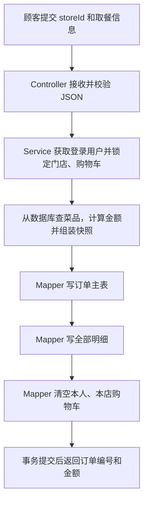

# 10.1 提交订单与超时取消实现讲解

这次完成的是 `POST /app/order/submit`。它把当前顾客在一家门店的购物车，转换成一份订单和若干条明细，再清空这部分购物车。

接口备注要求的四件事都已实现：事务、菜品快照、BigDecimal 金额计算、15 分钟未接单自动取消。Redis 仍参与已有的登录校验和菜单缓存；本次结算及超时扫描使用数据库。

## 一、先与你原来写的代码对比

你已经写对了这些入口：

```java
@PostMapping("/submit")
// 调用 AppOrderService，返回 Result.success(...)
Long userId = UserContextUtil.getCurrentUserId();
```

这说明你已经能把路由、业务层、登录身份连接起来了。

原来下面的判断需要调整：

```java
if (!order.getUserId().equals(UserContextUtil.getCurrentUserId())) {
    throw new BizException("用户不匹配");
}
```

文档明确说前端不需要传 userId。正常请求没有这个字段时，`order.getUserId()` 就是 null，再调用 `.equals()` 会空指针。正确做法是直接使用登录信息里的 userId，写到新订单中。

原来的 submit 方法还没有返回结果，订单和明细的 Mapper 也尚未实现。这次补完了整个链路。

和前一次 9.4 相比，9.4 主要是在一条 DELETE 中限定“购物车 ID + 当前用户”。10.1 增加的难度是：多个表一起成功、多件菜一起计价、并发时保持结算内容稳定，以及脱离 HTTP 请求的后台任务。这部分新代码由我补齐，理解并复写这些关键步骤后，才算转化成你自己的能力。

## 二、这次用到的文件

下面链接指向原项目，行号对应本次完成的版本。

| 文件 | 负责什么 |
| --- | --- |
| [OrderSubmitDTO](/D:/idea/Project/ordering-server/src/main/java/com/wys/orderingserver/pojo/OrderSubmitDTO.java) | 接收 storeId、remark、pickupType、pickupTime |
| [AppOrderController](/D:/idea/Project/ordering-server/src/main/java/com/wys/orderingserver/controller/app/AppOrderController.java:20) | 接收 JSON，校验参数，调用业务层 |
| [AppOrderServiceimpl](/D:/idea/Project/ordering-server/src/main/java/com/wys/orderingserver/service/impl/AppOrderServiceimpl.java:35) | 完成下单的全部业务步骤 |
| [CartMapper](/D:/idea/Project/ordering-server/src/main/java/com/wys/orderingserver/mapper/CartMapper.java:14) | 锁定并读取购物车，最后清理本人、本店的购物车 |
| [OrderMapper](/D:/idea/Project/ordering-server/src/main/java/com/wys/orderingserver/mapper/OrderMapper.java:19) | 保存订单主表，取消超时订单 |
| [OrderDetailMapper](/D:/idea/Project/ordering-server/src/main/java/com/wys/orderingserver/mapper/OrderDetailMapper.java:10) | 保存每道菜的快照明细 |
| [OrderSubmitVO](/D:/idea/Project/ordering-server/src/main/java/com/wys/orderingserver/pojo/OrderSubmitVO.java) | 仅返回 id、orderNo、amount |
| [OrderSchedulingConfig](/D:/idea/Project/ordering-server/src/main/java/com/wys/orderingserver/config/OrderSchedulingConfig.java:8) | 开启 Spring 定时调度 |
| [OrderTimeoutTask](/D:/idea/Project/ordering-server/src/main/java/com/wys/orderingserver/task/OrderTimeoutTask.java:23) | 后台周期扫描超时订单 |

生产 Mapper 继续使用你要求的注解 SQL 与字符串拼接风格。

## 三、按实际执行顺序看一次下单



Controller 入口是第 21 行：

```java
public Result<OrderSubmitVO> submit(@Valid @RequestBody OrderSubmitDTO request)
```

`@RequestBody` 把请求 JSON 转为对象；`@Valid` 检查门店 ID、取餐方式、备注长度。DTO 只提供顾客可填写的四个字段，并显式忽略其他字段。前端即便传入 amount、userId、status，也不会用于创建订单。

DTO 可以理解成“顾客填写的下单表格”；Order 是“真正存入数据库的订单”；VO 是“下单后交给顾客的回执”。这样也避免了直接校验 Order 时，错误要求前端传入服务端计算的 amount。

Service 中的顺序如下：

1. 第 37 行：从当前登录信息取得 userId。
2. 第 42 行：锁定门店，检查存在且营业中。
3. 第 50 行：查询并锁定该用户、该门店的购物车，空购物车立即失败。
4. 第 61 行：根据购物车里的 dishId 查数据库，检查菜品归属、上架状态及数量。
5. 第 71～86 行：计算单价、小计、总价，组装明细快照。
6. 第 89～101 行：组装订单，状态为 1 待接单，支付状态为 0 未支付。
7. 第 102 行：插入主表，并取得数据库生成的主键。
8. 第 105～111 行：给每条明细填入相同的 orderId，逐条保存。
9. 第 112 行：只清空当前用户、当前门店的购物车。
10. 第 115 行：返回三个字段。事务代理成功提交后，Controller 才会获得返回值。

订单号使用去掉连字符的 UUID，共 32 位，符合表的 VARCHAR(32) 长度。数据库原有唯一索引用于防止相同订单号入库。文档样例中的纯数字订单号是示例，没有规定必须使用该格式。

预约取餐时间按文档接收并保存，没有额外加入“必须在未来”“必须处于营业时间段”等尚未约定的规则。超时判定使用下单时间 create_time，与预约取餐时间无关。

## 四、备注 1：为什么三个操作可以同成功、同失败

位置：[AppOrderServiceimpl 第 35 行](/D:/idea/Project/ordering-server/src/main/java/com/wys/orderingserver/service/impl/AppOrderServiceimpl.java:35)。

```java
@Transactional(rollbackFor = Exception.class)
public OrderSubmitVO submit(OrderSubmitDTO request)
```

你可以把它理解成：数据库先把这一次业务的修改放在同一份“待确认清单”里。

```text
写订单主表       成功
写第一条明细     成功
写第二条明细     失败，抛出异常
--------------------------------
回滚：主表和第一条明细都不保留，购物车也保留
```

即使是清空购物车的 SQL 已经执行，后面的影响行数检查发现异常并抛错，事务也会撤销刚才的删除，以及此前写入的订单和明细。

在这个项目中，Spring 管理事务，MyBatis 的这些 Mapper 使用同一数据源和当前事务的连接。因此注解应放在串起所有步骤的业务方法上。异常必须继续向外抛，事务代理才能按规则回滚；不能捕获异常后当作正常成功返回。

三个写库步骤按顺序在当前请求线程执行。普通 Spring 数据库事务绑定当前线程，不会自动传播给方法里新创建的线程，所以这里没有使用 `new Thread()`、`@Async` 或 CompletableFuture 拆分写库步骤。[Spring 事务说明](https://docs.spring.io/spring-framework/docs/current/javadoc-api/org/springframework/transaction/annotation/Transactional.html)

还要区分两件事：

| 概念 | 本项目中的作用 |
| --- | --- |
| 事务 | 中途失败时，将本次已经执行的数据库修改一起撤销 |
| 行锁 | 这次结算尚未结束时，让冲突的修改等待，避免边结算边改数据 |

## 五、下单时的并发保护

第 42 行复用了原来的门店锁。现有管理端改菜、下架、删店，以及 9.2 加购，也先锁定同一个门店。

因此，顾客下单持有门店锁时，另一条遵循相同规则的请求无法同时修改本店菜品价格或插入新的加购条目。下单随后还会锁定本人、本店已有的购物车行，挡住 9.3 的数量修改和 9.4 的条目删除。

```sql
select * from t_cart
where user_id = #{userId} and store_id = #{storeId}
order by id asc for update
```

例子：购物车里有 2 份鸡丁，每份 38 元。

| 先后顺序 | 结果 |
| --- | --- |
| 改为 9 份先提交，下单随后取得购物车锁 | 下单读取 9 份，按 9 份结算 |
| 下单先锁住 2 份，修改数量随后到达 | 修改等待；下单按 2 份保存并清空购物车；修改继续后发现条目已不存在 |
| 下单先锁住门店，加购随后到达 | 加购等待；下单提交后，加购形成新的购物车条目 |
| 两个请求同时提交同一份购物车 | 先完成者创建订单并清空购物车，后一个看到购物车为空 |

这些锁由数据库提供，连接到同一数据库的不同应用实例也会受约束。这里没有使用 Java 的 synchronized，也没有再加 Redis 分布式锁。

当前设计复用了项目现有的门店锁，容易理解并保持写操作协调，但同一家店的下单会排队。高并发场景可以再设计更细的锁粒度。以后新增菜单写操作，也需要遵守当前门店锁约定。

唯一订单号本身不等于“防重复下单”。目前同一购物车的并发提交由锁和事务保护；第二次请求得到“购物车为空”，并不是重复返回第一次成功结果。文档没有请求幂等号，本次没有新增这一协议。

## 六、备注 2：菜品快照就是复制一份下单时的数据

位置：[AppOrderServiceimpl 第 78 行](/D:/idea/Project/ordering-server/src/main/java/com/wys/orderingserver/service/impl/AppOrderServiceimpl.java:78)。

```java
OrderDetail detail = new OrderDetail();
detail.setDishId(dish.getId());
detail.setDishName(dish.getName());
detail.setDishImage(dish.getImage());
detail.setDishPrice(price);
detail.setQuantity(cart.getQuantity());
detail.setAmount(subtotal);
```

假设下单时菜单是：宫保鸡丁，38 元，图片 A。保存后就有两份独立记录：

| 表 | 名字 | 单价 | 图片 |
| --- | --- | --- | --- |
| t_dish 菜单 | 宫保鸡丁 | 38.00 | A |
| t_order_detail 订单明细 | 宫保鸡丁 | 38.00 | A |

商家以后把菜单改成“招牌鸡丁、42 元、图片 B”，只改变 t_dish。订单明细仍然是原来的名字、38 元、图片 A。

所以“快照”不需要截图，也不需要 Redis，只需把当时的字段值复制并写进明细表。明细中的 dishId 仅用于追溯；以后开发订单详情时，要读取明细快照，不能重新关联当前菜单来展示历史价格。

主表先插入，明细后插入，是因为明细需要 orderId：

```java
@Options(useGeneratedKeys = true, keyProperty = "id")
int insert(Order order);
```

假设数据库生成主键 500，MyBatis 会把 500 回填到 `order.id`，Service 再执行 `detail.setOrderId(order.getId())`。同一订单的全部明细就关联到了 500。

## 七、备注 3：BigDecimal 如何计算金额

位置：[AppOrderServiceimpl 第 57 行](/D:/idea/Project/ordering-server/src/main/java/com/wys/orderingserver/service/impl/AppOrderServiceimpl.java:57)。

```java
BigDecimal total = new BigDecimal("0.00");
BigDecimal subtotal = price.multiply(BigDecimal.valueOf(cart.getQuantity()));
total = total.add(subtotal);
```

逐项算一次：

| 菜品 | 数据库单价 | 数量 | 小计 |
| --- | --- | --- | --- |
| 鸡丁 | 38.00 | 2 | 76.00 |
| 土豆丝 | 16.00 | 3 | 48.00 |
| 合计 | | | 124.00 |

`multiply` 做乘法，`add` 做加法。BigDecimal 的运算返回新对象，所以必须写 `total = total.add(subtotal)`；仅调用 `total.add(subtotal)` 不会改变 total。

价格来自数据库的 DECIMAL，数量来自数据库购物车的 INT。Service 用 BigDecimal 运算，最终仍保存到 DECIMAL(10,2)，这条链路中没有转换成 double。

`validPrice` 还检查价格大于 0，金额未超过字段容量，并使用 `setScale(2, RoundingMode.UNNECESSARY)` 确认金额能精确表示为两位小数。异常数据直接拒绝下单，不静默改价。

## 八、备注 4：15 分钟未接单自动取消

这是一条独立的后台流程，顾客不需要再发请求来触发它。

### 1. 开启定时调度

位置：[OrderSchedulingConfig 第 9 行](/D:/idea/Project/ordering-server/src/main/java/com/wys/orderingserver/config/OrderSchedulingConfig.java:9)。

```java
@EnableScheduling
```

配置默认开启。它让 Spring 注册标有 `@Scheduled` 的方法。[Spring 调度说明](https://docs.spring.io/spring-framework/reference/integration/scheduling.html)

### 2. 规定多久检查一次

位置：[OrderTimeoutTask 第 24 行](/D:/idea/Project/ordering-server/src/main/java/com/wys/orderingserver/task/OrderTimeoutTask.java:24)。

```java
@Scheduled(fixedDelayString = "${ordering.order-timeout.scan-delay-ms:60000}",
        initialDelayString = "${ordering.order-timeout.initial-delay-ms:10000}")
```

`${配置名:默认值}` 表示优先读取配置，未配置时使用冒号后的默认值。默认单位为毫秒：

- 启动后等 10000 毫秒，即 10 秒，进行第一次扫描。
- 一轮扫描结束后，等 60000 毫秒，即 60 秒，再开始下一轮。

fixedDelay 从上一轮结束时算间隔，不是承诺每个整分钟开始执行。这和“订单经过 15 分钟才算超时”是两个不同的时间设置。[Spring fixedDelay 说明](https://docs.spring.io/spring-framework/reference/integration/scheduling.html#scheduling-annotation-support-scheduled)

### 3. 算出该检查哪些订单

```java
LocalDateTime now = LocalDateTime.now(ZoneId.of("Asia/Shanghai")).withNano(0);
int rows = orderMapper.cancelTimedOut(now.minusMinutes(15), now);
```

假设现在 15:00，`now.minusMinutes(15)` 就是 14:45。数据库需要取消“14:45 及以前创建，并且到现在还没被接单”的订单。

对应 SQL：

```sql
update t_orders
set status = 4,
    cancel_reason = '商家超时未接单，订单自动取消',
    update_time = #{now}
where status = 1
  and create_time <= #{deadline}
```

这里的 `<=` 包含恰好满 15 分钟的订单。任务扫描全部门店，不需要从登录信息获取某个 storeId。原始建表脚本已经有 `idx_status_create(status, create_time)` 索引，所以无需额外改表。

订单默认状态 1、支付状态 0；任务只改变状态、取消原因和更新时间，保留订单明细及其他字段。支付或退款流程不在本接口文档范围内。

### 4. 真正涉及多线程的是哪一部分

```text
HTTP 请求线程：登录校验 → submit → 写库 → 提交 → 返回

Spring 调度线程：定期醒来 → 取消超时订单 → 等待下一轮
```

线程的创建和调度由 Spring 管理。每次扫描用一条 SQL 处理符合条件的订单，没有为每笔订单建立线程。

任务里的 `@Transactional` 在调度线程这次调用中开启事务，它与顾客下单时的事务是两次独立事务。15 分钟也不是把下单事务一直开着等 15 分钟。

后台线程没有某个顾客的请求上下文，因此任务不能调用 `UserContextUtil.getCurrentUserId()`。我们直接按数据库状态和时间筛选。普通 ThreadLocal 不会自动把请求线程的数据复制到后台线程；测试已验证后台任务无需登录身份也能运行。

### 5. 商家恰好在同一时刻接单，会不会被误取消

接单 SQL 原来就有：

```sql
update t_orders set status = 2, ...
where id = ... and store_id = ... and status = 1
```

超时 SQL 也有 `status = 1`，所以竞争时由数据库行锁协调：

| 先完成的操作 | 后执行的操作看到什么 | 最终状态 |
| --- | --- | --- |
| 商家接单提交 | 超时 UPDATE 不再匹配 status=1 | 2 已接单 |
| 超时取消提交 | 商家接单检查发现已经取消 | 4 已取消，接单失败 |

关键是把原状态条件写在 SQL 的 WHERE 中。仅在 Java 里先查一次状态，随后无条件更新，无法提供同样的保护。

同理，多个应用实例同时扫描时，已经被一个实例取消的订单，不再符合其他实例的 status=1 条件；重复扫描不会反复改写它。

### 6. 项目重启和扫描延迟

待接单状态与创建时间都在数据库中。停机期间任务不运行；项目重新启动后，下一轮会继续扫描积压的超时订单。

这套方案在“满 15 分钟后的下一次扫描”处理订单，不保证在第 15 分钟的那一秒执行。在调度和数据库正常时，额外延迟通常接近一个扫描周期；扫描耗时、线程调度或停机还会延长它。

## 九、Redis 在这个接口里是什么角色

| 功能 | 当前实现 |
| --- | --- |
| 检查 token 是否仍有效 | 已有 LoginInterceptor 查询 Redis |
| 浏览菜单的列表缓存 | 已有 DishCacheUtil |
| 下单时取得价格并保存快照 | 查询数据库，不读取菜单缓存 |
| 超时取消 | Spring 定时任务扫描数据库 |

不使用菜单缓存结算，是为了按数据库实时价格保存订单。菜单缓存用于减少浏览时查库的次数，不承担这次交易的金额依据。

把一个 Redis key 设置成 15 分钟过期，只会改变 Redis 中这个 key 的状态，不会自行执行 MySQL 的 UPDATE。若使用过期通知，还需要另外写监听器和取消逻辑。Redis 官方也明确说明过期通知不保证在 TTL 归零时立即发出，订阅者断线期间的消息还可能丢失。[Redis 过期通知说明](https://redis.io/docs/latest/develop/pubsub/keyspace-notifications/)

因此本次按文档的“定时任务”要求，使用数据库扫描。你可以先把事务、状态条件、后台扫描这条链路掌握，再学习其他延迟任务方案。

也不要把 DishCacheUtil 里的短暂重试等待，与订单超时混在一起。前者是在竞争缓存重建锁时短暂等待；这里的超时任务是周期筛选数据库中的历史记录。

## 十、如何调用

先登录拿到 token，并用 9.2 给目标门店加入至少一道上架菜品。然后发送：

```http
POST /app/order/submit
Authorization: 登录接口返回的原始token
Content-Type: application/json
```

```json
{
  "storeId": 1,
  "pickupType": 1,
  "remark": "不要香菜"
}
```

成功时返回 id、orderNo、amount。金额以实际购物车和当前数据库菜品价格计算。不要在请求中传 userId 或 amount。

若购物车已经空了，返回：

```json
{"code":1,"message":"购物车为空，无法下单","data":null}
```

下单完成后，在数据库查看 t_orders、t_order_detail，再查询当前用户本店的 t_cart，就能把一次业务的结果对照起来。超时取消只改订单状态，不自动把条目重新放回购物车。

## 十一、验证范围和学习顺序

新增的 43 项专用测试覆盖：参数校验、身份隔离、实时价格、快照、主键回填、金额精度、各阶段失败回滚、重复及并发下单、并发加购/改数量/改价、超时边界、接单竞争、后台调度触发、调度开关、单轮故障后的继续扫描。

完成后的全量回归：30 个测试类、781 项测试，失败 0、错误 0、跳过 0。

数据库测试使用 H2 的 MySQL 模式，Redis 使用带状态的模拟对象；另外用真实 Spring 调度线程验证定时方法确实触发。尚未连接真实 MySQL、Redis 做联调。

建议你按下面顺序阅读，先不要一次读完全部测试：

1. 从 Controller 第 21 行走到 Service 第 115 行，写下每一步调用哪个 Mapper。
2. 自己算一遍 38×2 + 16×3，并解释主表金额与明细金额分别是什么。
3. 看懂“主表插入 → 主键回填 → 明细填 orderId → 清空购物车”的依赖顺序。
4. 单独阅读 OrderTimeoutTask 的 34 行代码，说明谁来调用、多久调用、SQL 筛选什么。
5. 最后用接单与取消的两条 SQL，解释为什么两者都带 status=1。

这几个问题能够不看答案讲清楚，就掌握了本次最重要的实现思路。
