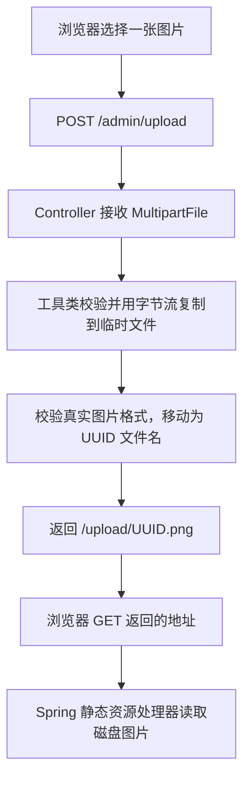

# 11.1 图片上传与 IO 流实现讲解

本次完成 `POST /admin/upload`：接收一张图片，保存到服务器本地目录，返回能直接访问的相对地址。

## 一、先和上一次 10.4 作对比

| 对比项 | 10.4 取消订单 | 11.1 图片上传 |
| --- | --- | --- |
| 请求内容 | 路径中的订单 ID | multipart 表单中的图片文件 |
| 主要调用链 | Controller → Service → Mapper → 数据库 | Controller → FileUploadUtil → 磁盘文件 |
| 保存的内容 | 数据库中的订单状态 | 图片原始字节 |
| 失败处理 | 数据库事务回滚 | 关闭流，清理未完成的临时文件 |
| 成功响应 | data=null | data 为图片访问地址 |

你当前上传 Controller 原来是预留空类，工具类有基本的 transferTo 保存逻辑。本次由我补齐接口、校验、流复制、异常处理和图片访问映射。这里适合重点学习文件读写，而不是据此判断你已经独立掌握了 IO。

这个功能不需要新增 Mapper，因为它没有执行 SQL。以后调用新增或修改菜品接口时，才把返回的图片地址保存到菜品表的 image 字段。

## 二、整体分为“上传”和“访问图片”两条流程



第一次请求把图片存起来；第二次请求根据地址取图片。返回一个 URL 字符串本身，并不会让图片自动出现，必须有磁盘文件和对应的访问映射。

## 三、先区分四样东西

假设上传文件原名是 chicken.png，服务器生成的新名字是某个 32 位 UUID。

| 内容 | 示例 | 是什么 |
| --- | --- | --- |
| 原始文件名 | chicken.png | 浏览器提供的名字 |
| 磁盘文件路径 | D:/idea/Project/ordering-server/upload/UUID.png | 服务器保存图片的位置 |
| 相对访问地址 | /upload/UUID.png | 接口 data 返回的字符串 |
| 完整访问地址 | http://localhost:8080/upload/UUID.png | 浏览器访问的 URL |

图片内容是一串二进制字节。路径和 URL 是定位它的字符串，两者都不是图片内容本身。

## 四、Controller 怎么接收图片

位置：[FileUploadController 第 24 行](/D:/idea/Project/ordering-server/src/main/java/com/wys/orderingserver/controller/common/FileUploadController.java:24)。

```java
@PostMapping(consumes = MediaType.MULTIPART_FORM_DATA_VALUE)
public Result<String> upload(@RequestParam("file") MultipartFile file,
                             MultipartHttpServletRequest request)
```

这里的参数来自 multipart/form-data 表单字段 file，所以使用 `@RequestParam("file") MultipartFile`。[Spring multipart 说明](https://docs.spring.io/spring-framework/reference/web/webmvc/mvc-controller/ann-methods/multipart-forms.html)

MultipartFile 是 Spring 提供的上传文件对象，可以取得：

```java
file.getOriginalFilename(); // 客户端原始文件名
file.getSize();             // 文件大小，单位为字节
file.isEmpty();             // 是否没有文件内容
file.getInputStream();     // 用来读取文件内容的输入流
```

Spring 已经解析了 multipart 请求，并可能将上传内容暂存在内存或临时磁盘。我们从 MultipartFile 取得流即可，不需要自己解析 HTTP 边界。

Controller 还检查本次请求恰好包含一个文件，之后执行：

```java
return Result.success(fileUploadUtil.uploadImage(file));
```

工具返回地址，Controller 把它放进 Result 的 data 字段。

## 五、为什么工具类现在是 Spring Bean

位置：[FileUploadUtil 第 28 行](/D:/idea/Project/ordering-server/src/main/java/com/wys/orderingserver/utils/FileUploadUtil.java:28)。

```java
@Component
public class FileUploadUtil
```

构造方法接收三个配置：磁盘目录、URL 前缀、单文件大小上限。字段都是 final，初始化完成后不在请求之间修改。

Controller 与 WebConfig 注入同一个工具 Bean，共用同一份目录和前缀，避免“保存到 A 目录，访问时却去 B 目录找”的问题，也不再使用可变的静态 uploadDir。

工具类并不要求所有方法都必须是 static。需要配置注入并由多个组件共用时，可以交给 Spring 管理。

## 六、上传入口先做哪些检查

位置：[FileUploadUtil 第 58 行](/D:/idea/Project/ordering-server/src/main/java/com/wys/orderingserver/utils/FileUploadUtil.java:58)。

```java
if (file == null || file.isEmpty()) throw new BizException("上传图片不能为空");
if (file.getSize() > maxBytes) throw tooLarge();
String suffix = suffix(file.getOriginalFilename());
```

现在支持 jpg、png、gif，jpeg 作为 JPG 的常见扩展名也支持，最后统一保存为 .jpg。大小写后缀会统一处理。

客户端原始文件名只用于识别扩展名，不用于拼接磁盘路径。正式名字由服务器生成，所以同名文件不会相互覆盖，原始文件名中的目录片段也不能决定保存位置。

配置中增加了：

```yaml
spring:
  servlet:
    multipart:
      max-file-size: 5MB
      max-request-size: 6MB
```

单文件默认最多 5MB；整个请求允许 6MB，为表单边界等内容预留空间。工具类读取同一份 max-file-size 配置，并在实际读取时再次累计字节数。

## 七、先创建临时文件

第 64～67 行：

```java
Files.createDirectories(uploadDir);
temporary = Files.createTempFile(uploadDir, "upload-", ".tmp");
copyToTemporaryFile(file, temporary);
```

Path 表示路径。`uploadDir.resolve(filename)` 只是组装路径；真正执行创建、读写的是 Files 等文件操作方法。

`createDirectories` 确保目录存在，目录已经存在时可以继续使用。`createTempFile` 真正创建一个空的临时文件，接下来把上传内容复制进去。

临时文件像一份尚未验收的草稿。只有内容复制完成、图片校验通过，才移动为正式文件并返回访问地址。

## 八、IO 核心：从输入流读取，向输出流写入

位置：[FileUploadUtil 第 88 行](/D:/idea/Project/ordering-server/src/main/java/com/wys/orderingserver/utils/FileUploadUtil.java:88)。

```java
try (InputStream input = file.getInputStream();
     OutputStream output = Files.newOutputStream(target, StandardOpenOption.WRITE,
             StandardOpenOption.TRUNCATE_EXISTING)) {
    byte[] buffer = new byte[8192];
    long total = 0;
    int length;
    while ((length = input.read(buffer)) != -1) {
        total += length;
        if (total > maxBytes) throw tooLarge();
        output.write(buffer, 0, length);
    }
    if (total == 0) throw new BizException("上传图片不能为空");
}
```

### 1. InputStream 是输入流

```java
InputStream input = file.getInputStream();
```

站在这段 Java 程序的角度，input 用来读入上传文件的字节。这里不要求你知道 MultipartFile 的内容此前是在内存还是临时磁盘中。

### 2. OutputStream 是输出流

```java
OutputStream output = Files.newOutputStream(target, ...);
```

output 用来把字节写到指定的磁盘临时文件。这个文件已经由前面的 createTempFile 创建。

### 3. buffer 是一块可以反复使用的搬运空间

```java
byte[] buffer = new byte[8192];
```

它最多能暂存 8192 个字节，即 8KB。可以把它理解成搬运箱：装入一批字节，写出去，再装下一批。

```text
MultipartFile 的内容 → input → buffer → output → 磁盘临时文件
```

图片用字节流复制，不用 FileReader、FileWriter 这样的字符流。字符流用于文本转换，不能拿来原样搬运图片二进制内容。

### 4. read 返回本次真正读到的字节数

```java
length = input.read(buffer);
```

读取的数据放进 buffer，返回值放进 length。它每次最多读 buffer.length 个字节，可能少于这个数量；返回 -1 才表示读到末尾。[Java InputStream 说明](https://docs.oracle.com/en/java/javase/21/docs/api/java.base/java/io/InputStream.html)

所以循环条件：

```java
while ((length = input.read(buffer)) != -1)
```

意思是“读取一批，只要还没结束，就处理这一批”。

### 5. write 只写入本次有效的数据

```java
output.write(buffer, 0, length);
```

三个参数分别是：数据所在的数组、从下标 0 开始、本次写 length 个字节。

假设文件共有 10000 字节，一种可能的读取过程是：

| 第几次读取 | length | 本次写入 | 累计写入 |
| --- | --- | --- | --- |
| 第一次 | 8192 | 8192 字节 | 8192 |
| 第二次 | 1808 | 1808 字节 | 10000 |
| 第三次 | -1 | 结束循环 | 10000 |

第二次 buffer 剩余的位置可能还保留上一批旧内容。因此不能直接写 `output.write(buffer)` 把整个数组都写出去，必须只写实际的 length。

本次测试还刻意让每次读取最多返回 257 字节，验证短读和最后不足一块的情况不会破坏文件内容。

### 6. total 是实际读取的累计字节数

客户端报告的大小先做一次检查；真正复制时再累计 total。实际读到的内容超过上限，就立即失败，避免只依赖元数据。

复制阶段使用 8KB 缓冲区，但 multipart 框架和图片解码仍有其他内存开销，因此同时设置了大小和图片像素限制。

## 九、为什么 try 后面要带括号

```java
try (InputStream input = ...;
     OutputStream output = ...) {
    ...
}
```

这是 try-with-resources。离开代码块时会自动关闭资源，发生异常时也会执行关闭，两个资源按声明的相反顺序关闭。

你之前分页中用过 `try (Page<...> page = ...)`，这里也是同一种资源管理语法，只是资源换成了 IO 流。

关闭流用于释放系统资源和文件句柄。在 Windows 上，文件仍被打开时，后面的移动或删除也可能受到影响。

## 十、为什么保存后还要检查图片内容

位置：[FileUploadUtil 第 105 行](/D:/idea/Project/ordering-server/src/main/java/com/wys/orderingserver/utils/FileUploadUtil.java:105)。

文件叫 a.png，不代表内容一定是 PNG。这里重新打开临时文件，交给 JDK ImageIO 判断格式并验证首帧能够解码，而不是只信扩展名或客户端 Content-Type。

校验还会检查实际图片格式是否与扩展名匹配，并限制为 2000 万像素以内，避免解码超大尺寸图片造成过多内存分配。

这部分的 ImageInputStream 是为了读取已经写好的临时文件、检查图片；前面的 InputStream 是为了复制上传内容，两次读取的目的不同。

原始文件不重新编码，因此保留原始字节，GIF 也不在上传时被转换成单张 JPG。这里验证的是首帧，不声称对动画的每一帧都进行完整校验。

## 十一、UUID 命名与失败清理

第 69～73 行：

```java
String filename = UUID.randomUUID().toString().replace("-", "") + "." + suffix;
Path target = uploadDir.resolve(filename);
Files.move(temporary, target);
temporary = null;
return urlPrefix + filename;
```

`Files.move` 将临时文件移动为正式文件，不使用覆盖已有文件的选项。正式名字来自 UUID，而不是客户端名字。

`temporary = null` 是把 Java 变量置空，表示本次保存成功，让 finally 不再处理临时路径。变量置空不会删除磁盘文件。

如果复制或校验失败，finally 会执行 `Files.deleteIfExists(temporary)` 清理本次尚未完成的临时文件。文件系统操作不会因为加上数据库事务注解就自动回滚，因此这里需要明确的清理逻辑。

IOException 会在服务器记录日志，返回给前端的是“图片上传失败，请稍后重试”，不把实际磁盘路径作为错误信息发给客户端。

## 十二、为什么返回 URL 后能访问图片

位置：[WebConfig 第 38 行](/D:/idea/Project/ordering-server/src/main/java/com/wys/orderingserver/config/WebConfig.java:38)。

```java
registry.addResourceHandler(fileUploadUtil.getUrlPrefix() + "**")
        .addResourceLocations(fileUploadUtil.getResourceLocation());
```

默认把 `/upload/**` 对应到配置中的磁盘目录。收到 `/upload/UUID.png` 的 GET 请求后，Spring 静态资源处理器找到目录里的 UUID.png，并把图片内容写入 HTTP 响应。

目录使用 Path.toUri() 转为资源位置，可处理空格、中文和 Windows 路径，也不再要求目录配置必须写结尾斜杠。

上传接口按文档继续免登录；图片访问前缀也加入拦截器排除范围，让浏览器可以直接打开图片。其他业务接口继续要求登录。找不到图片时返回 HTTP 404。

## 十三、如何使用与菜品接口衔接

在 Postman 或 Apifox 中：

1. 选择 POST，地址为 `http://localhost:8080/admin/upload`。
2. Body 选择 form-data。
3. 字段名填写 file，类型选 File，然后选择一张图片。
4. 让工具自动生成 Content-Type 和 boundary，不手动填写一个缺少边界的请求头。
5. 发送请求，拿到 data 中的地址，再用浏览器打开完整 URL。

成功示例：

```json
{"code":0,"message":"操作成功","data":"/upload/9f8e7d6c5b4a4e3f8d2c1b0a9e8f7d6c.png"}
```

之后调用新增或修改菜品接口时，把这个字符串填入 image 字段：

```json
{"image":"/upload/9f8e7d6c5b4a4e3f8d2c1b0a9e8f7d6c.png"}
```

图片内容保存在磁盘；菜品表 image 字段保存地址。上传与保存菜品是两次独立请求。

## 十四、验证范围

新增 51 项专用测试：38 项真实文件 IO 测试、13 项接口与访问测试。覆盖格式、大小、文件名、短读、流关闭、失败清理、同名并发、目录配置、返回地址访问以及原有登录保护。

其中真实 HTTP 测试在本机随机端口启动 Tomcat，验证 multipart 上传、匿名读取图片、超过 5MB 的文件在 Servlet 层被拒绝，以及错误 boundary 的处理。上传与取回的图片字节完全一致。

测试使用临时磁盘目录；其他业务依赖使用内存 H2 和模拟 Redis，没有写入业务上传目录或业务数据库。

完成后的全量回归为 35 个测试类、941 项测试，失败 0、错误 0、跳过 0。
